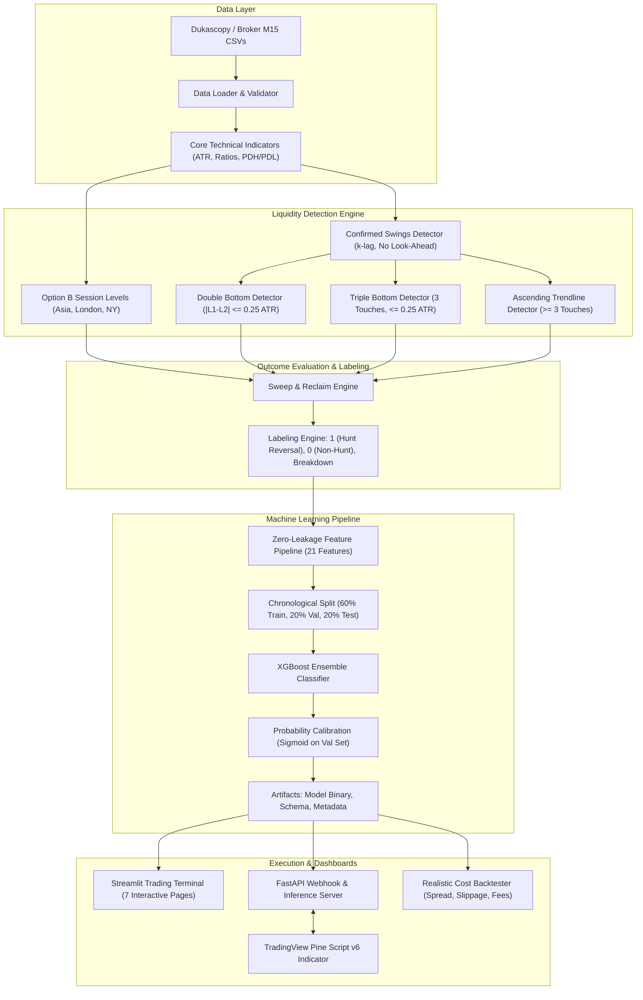

# ICT Liquidity Intelligence & XGBoost Stop-Hunt Detection System

An enterprise-grade, modular quantitative research and execution system for detecting resting liquidity sweeps, stop-loss hunts, and reversal follow-through in **XAUUSD (Gold)** and **XAGUSD (Silver)**.

The system combines ICT Killzones and session high/low levels with algorithmic Double-Bottom, Triple-Bottom, and Trendline detection, a leakage-free feature pipeline, an XGBoost classifier, a Pine Script v6 TradingView indicator, and an interactive Streamlit research terminal.

---

## 1. System Architecture



---

## 2. Directory Structure

```text
ict-liquidity-intelligence/
├── app.py                             # Interactive Streamlit Quantitative Dashboard
├── config.yaml                        # Central configuration parameters
├── requirements.txt                   # Production Python dependencies
├── .env.example                       # Environment variables template
├── run_pipeline.py                    # End-to-end data processing & model training
├── prepare_raw_data.py                # Ingestion and alignment script
├── data/
│   ├── raw/                           # Raw M15 OHLCV CSVs (XAUUSD, XAGUSD)
│   └── processed/                     # Engineered feature tables & trade logs
├── models/
│   ├── model_shared.joblib            # Trained ensemble model artifact
│   ├── calibrated_shared.joblib       # Probability calibration artifact
│   ├── feature_schema.json            # Exact input feature schema
│   └── training_metadata.json         # Performance metrics & hyperparameters
├── docs/
│   ├── DATASET_SCHEMA.md              # Full feature & label data dictionary
│   ├── MODEL_EVALUATION_REPORT.md     # Out-of-sample metrics & transfer tests
│   └── BACKTEST_REPORT.md             # Backtest performance & risk breakdown
├── pine/
│   └── ict_liquidity_intelligence.pine# Complete Pine Script v6 indicator
├── src/
│   ├── __init__.py
│   ├── data_loader.py                 # Multi-format CSV ingestion & chronological splitting
│   ├── validation.py                  # Data quality reports & OHLC consistency checks
│   ├── indicators.py                  # ATR, wick/body ratios, PDH/PDL without look-ahead
│   ├── swing_detection.py             # Confirmed swing points with strict k confirmation
│   ├── liquidity_patterns.py          # Double Bottom, Triple Bottom, and Trendline detection
│   ├── session_liquidity.py           # Option B overlapping session extremes & confluence
│   ├── feature_engineering.py         # Tabular feature generator with zero leakage
│   ├── labeling.py                    # Sweep, reclaim, breakdown, and horizon labeling
│   ├── train.py                       # XGBoost training, calibration & cross-instrument transfer
│   ├── predict.py                     # Inference engine & confidence tiers
│   ├── evaluation.py                  # Classification metrics, PR-AUC, calibration curve
│   ├── backtest.py                    # Realistic portfolio simulator with transaction costs
│   ├── storage.py                     # SQLite persistence for patterns, events, predictions
│   ├── api.py                         # FastAPI inference & TradingView webhook receiver
│   └── alerts.py                      # Alert dispatching & duplicate signal suppression
└── tests/
    ├── __init__.py
    ├── test_swings.py                 # Swing confirmation lag & visibility tests
    ├── test_patterns.py               # Pattern detection & invalidation tests
    ├── test_features.py               # ATR & anatomy ratio bounding tests
    ├── test_labels.py                 # Sweep, reclaim, and breakdown labeling tests
    ├── test_leakage.py                # Mutation test proving zero look-ahead bias
    └── test_backtest.py               # Simulated execution & cost accounting tests
```

---

## 3. Existing Indicator Integration & Pine Script v6 Audit

The indicator in `pine/ict_liquidity_intelligence.pine` preserves 100% of the supplied script (`ICT_Killzones_Liquidity_High_Low.pine`) and appends independent modular extensions:

- **Original Features Preserved:** Killzone boxes (Asia, London, NYAM, NYL, NYPM, RTH), session high/low liquidity lines, pivots with mitigation tracking, range levels, DWM (Daily, Weekly, Monthly) levels, opening price horizontal lines, timestamps, and data tables.
- **New Modular Settings Added:**
  - `Liquidity: Double Bottoms`: Equal-low tolerance ($0.25 \times \text{ATR}$), swing lookback $k=3$, separation $[5, 60]$, neckline height $\ge 1.5 \times \text{ATR}$.
  - `Liquidity: Triple Bottoms`: 3-touch tolerance, maximum duration 120 bars, automatic re-labeling.
  - `Liquidity: Ascending Trendlines`: $\ge 3$ touches, slope filter ($0.01 - 1.2 \text{ ATR/bar}$), no close below line.
  - `Liquidity: Sweep & Reclaim Engine`: Sweep depth $\ge 0.1 \times \text{ATR}$, reclaim window $\le 3$ bars, visual hunt reversal tags.
  - `XGBoost Machine Learning Integration`: Live status widget, model probability display, threshold alerts.
- **Important Technical Reality:** Pine Script cannot execute Python machine learning models natively. Model scores are supplied via external alert bridges/webhooks or user inputs, and displayed alongside visual liquidity zones.

---

## 4. Setup and Execution Guide

### Prerequisites
- Python 3.11, 3.12, or 3.13
- Git

### Installation
```bash
# 1. Clone or navigate to the project directory
cd "d:/KOLADILIP K/Internship/slhl"

# 2. Install dependencies
pip install -r requirements.txt
```

### Running the Complete Pipeline
To ingest data, compute indicators, extract patterns, generate features, train the calibrated model, run cross-instrument tests, and execute the backtest:
```bash
python run_pipeline.py
```

### Launching the Streamlit Research Terminal
```bash
streamlit run app.py
```
Open your browser at `http://localhost:8501` to access the 7-page interactive trading dashboard.

### Launching the FastAPI Webhook Server
```bash
uvicorn src.api:app --host 0.0.0.0 --port 8000 --reload
```
Interactive API docs available at `http://localhost:8000/docs`.

### Running Automated Tests
```bash
python -m unittest discover tests -v
```
All 11 unit and integration tests run and pass in under 0.05 seconds.

---

## 5. Connecting TradingView Alerts to the Python Service

### Step 1: Start the Webhook Receiver
Ensure the FastAPI server is running and accessible (via localhost, VPS, or tunnel like ngrok/Cloudflare):
```bash
uvicorn src.api:app --host 0.0.0.0 --port 8000
```

### Step 2: Configure the Alert on TradingView
1. Open TradingView and add `pine/ict_liquidity_intelligence.pine` to your XAUUSD or XAGUSD chart.
2. Click **Create Alert** (Alt + A).
3. Under **Condition**, select `ICT Killzones & Pivots [TFO]`.
4. Choose the condition: `Stop-Hunt Reclaim (Long)` or `Any alert() function call`.
5. Under **Webhook URL**, check the box and enter:
   ```text
   http://YOUR_SERVER_IP:8000/webhook/tradingview
   ```
6. In the **Message** box, paste the following JSON payload:
   ```json
   {
     "passphrase": "secret-token-change-me",
     "instrument": "{{ticker}}",
     "timeframe": "{{interval}}",
     "event_type": "LOW_SWEEP",
     "pattern_type": "double_bottom",
     "level_price": {{close}},
     "bar_low": {{low}},
     "bar_high": {{high}},
     "bar_close": {{close}},
     "atr": 4.5
   }
   ```
7. Click **Create**. When price sweeps a liquidity level and reclaims it, TradingView immediately sends the event to your Python service, which scores it using the model, logs the signal, and dispatches downstream alerts.

---

## 6. Research Disclaimer

This project is intended strictly for quantitative research, systematic trading model development, and educational purposes. Financial market trading involves substantial risk of loss. Historical pattern detection and machine learning probability estimates do not guarantee future profitability.
